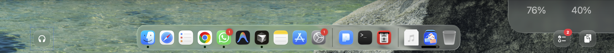
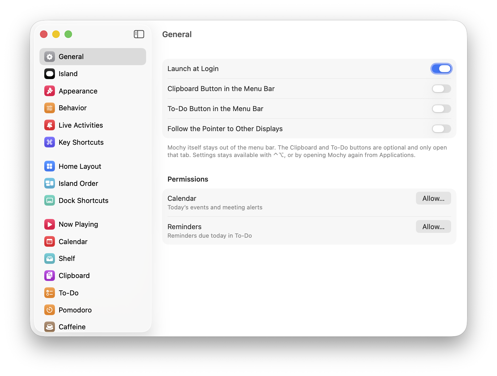

# Mochy

<table>
  <tr>
    <td width="140">
      
    </td>
    <td style="font-size: 16px;">
      &nbsp;&nbsp;&nbsp;&nbsp;A notch utility for macOS 14 and later. It sits in the camera housing and opens into a panel for what's playing, the calendar, files, clipboard history, to-dos, and timers.
    </td>
  </tr>
</table> 

Each launch from quit writes “hello” across a black card the size of the island, in Macintosh Skeletal, then settles into the pill.


## Island

The closed pill shows one live activity at a time: download progress (including AirDrop, file transfers, and copies onto a USB drive), a Pomodoro, timer, or stopwatch, now playing, caffeine, or charging. The timer and the battery percent keep moving while the pill is closed.

Hover or click the notch to open the panel. Tabs sit to the left of the camera. The command palette, now playing, caffeine, dock shortcuts, pin, settings, and quit sit to the right. The dock-shortcut button uses the same dock icon as Settings. Swipe up to collapse and swipe down to expand. Press Esc to close the palette or the island. Two idle timers are separate: one while the pointer rests on the island, and one after it leaves.

| Tab | What it does |
| --- | --- |
| Home | Up to four cards: Now Playing, Today, Quick Controls, To-Do, Battery, System, Weather |
| Shelf | Park files, drag them back out, convert images and PDFs, or hand them to AirDrop. Finished items can leave the shelf on their own after 5 minutes, 10 minutes, 30 minutes, or an hour |
| Clipboard | Searchable history. Click a row to copy it. Sounds include Pop, Click, Bubble, Chime, Glass, Bell, Note, Water Drop, and Cash |
| To-Do | A short list. Adding an item can play a sound, and ticking one off can play another. An https link turns blue; click the text to open it. Settings can hide the https and www prefix, strip tracking parameters, and put new items at the top or the bottom. A ticked item stays, struck through, until the island closes |
| Pomodoro | Pomodoro, countdown, and stopwatch |
| Calendar | A month you can move through, with each event's calendar color. Days with more than one calendar use a split dot |
| System |   Battery details |

Notes, Calculator, Search, Launcher, Emoji, and Mirror can be turned on in Settings › Tabs.


## Dock shortcuts

To-Do, Clipboard, and a connected Bluetooth device can sit beside the Dock. They are not Dock icons. Left and right chips move independently, from −350 to 350 points, and both can drop as far as 480 points below the Dock. Transparency and reflection control how much of the desktop shows through the glass.

One switch hides every chip and puts the same chips, positions, and glass back when you turn it on. That switch is also on the island, next to caffeine. Click a chip for its card. Press Esc to close the card.



## Now playing

Mochy reads the system Now Playing session, the same one Control Center uses. Music, Spotify, and other apps that are not a website still show. A website shows only when it is on the allow list in Settings. `youtube.com` also covers `youtu.be`, and `x.com` also covers Twitter. An empty list blocks every website. A new-track alert is not shown for a site on that list; the pill is enough.

Since macOS 15.4, only Apple-entitled processes may read that session. Mochy ships a small Objective-C bridge (`Native/MediaRemoteBridge.m`) loaded by `/usr/bin/perl`. A future macOS update could close that session.

## Key shortcuts

Shortcuts are global and can be changed in Settings › Key Shortcuts. They use Carbon hot keys.

| Shortcut | Action |
| --- | --- |
| ⌃⌥Space | Open or close the island |
| ⌃⌥K | Command palette |
| ⌃⌥C | Dock clipboard |
| ⌃⌥⇧C | Clipboard history |
| ⌃⌥T | To-Do |
| ⌃⌥S | Shelf |
| ⌃⌥P | Start or pause Pomodoro |
| ⌃⌥A | Toggle caffeine |
| ⌃⌥I | Pin the island open |
| ⌃⌥M | Play or pause media |
| ⌃⌥, | Settings |




## Build

Command Line Tools are enough:

```bash
cd ~/Desktop/mochy
./build.sh
open dist/Mochy.app
```

`build.sh` compiles the bridge with `clang` and the app with `swiftc`, assembles `dist/Mochy.app`, and ad-hoc signs it. Launch at Login needs the app in `/Applications`.

## URL scheme and local API

- `mochy://open`
- `mochy://close`
- `mochy://settings`
- `mochy://palette`
- `mochy://pomodoro`
- `mochy://caffeine`
- `mochy://tab/<home|shelf|clipboard|todo|timer|calendar|stats|…>`

The local API is off by default. Turn it on in Settings › Developer. It only accepts connections from this Mac.

```bash
curl -H "X-Mochy-Token: TOKEN" http://127.0.0.1:9999/status
curl -X POST -H "X-Mochy-Token: TOKEN" http://127.0.0.1:9999/show \
  -d '{"title":"Build finished","subtitle":"main","symbol":"hammer.fill","color":"#30D158","duration":4}'
curl -X POST -H "X-Mochy-Token: TOKEN" http://127.0.0.1:9999/expand -d '{"tab":"todo"}'
```

## Limitations

- Mochy does not replace the system volume and brightness indicators.
- CPU and GPU temperatures are not shown.
- Charge limiting, fan control, external-display brightness, and Face Unlock are not included.
- Clipboard history skips items that apps mark as concealed or transient, such as password managers.
