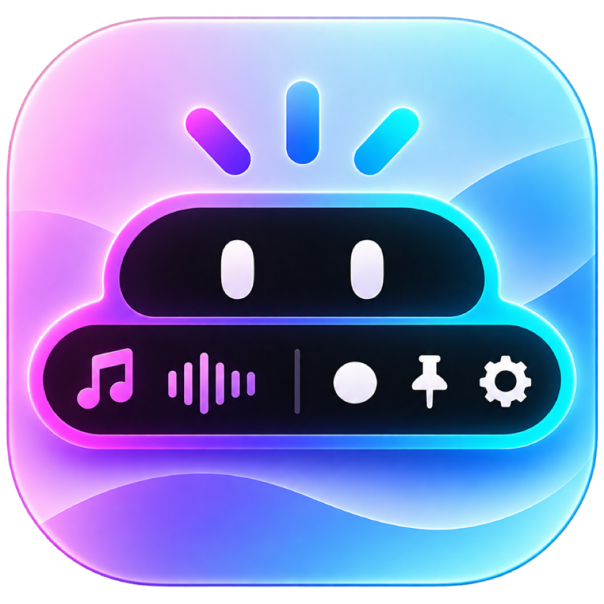
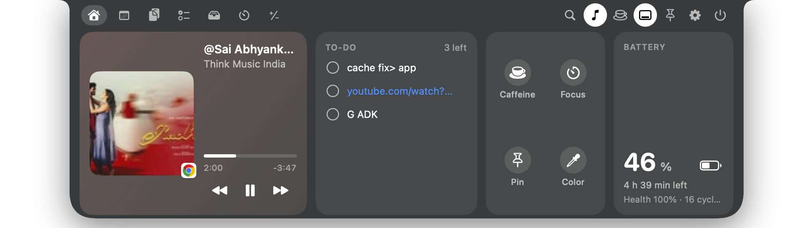
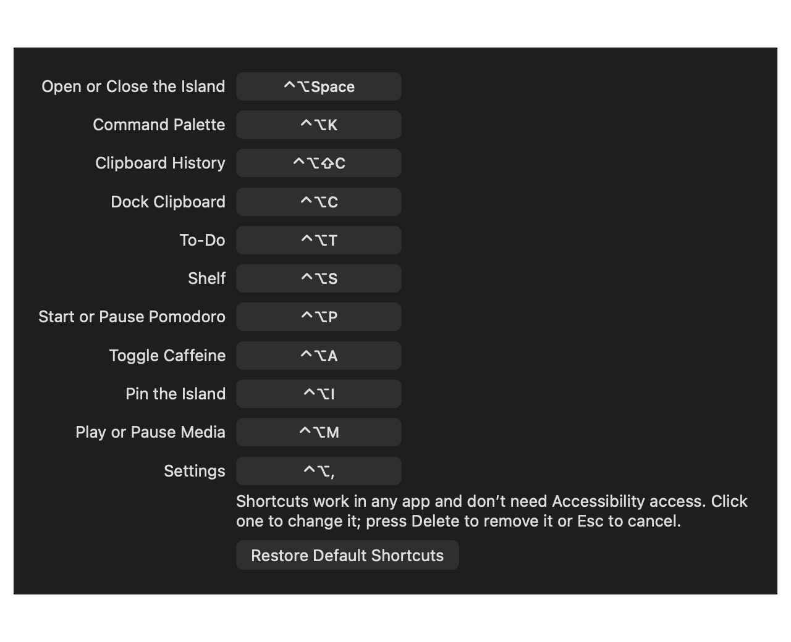

<div align="center">

  

  # Mochy

  ### The fluid Dynamic Island & productivity shelf for macOS.

  [](https://apple.com/macos)
  [-007AFF?style=for-the-badge)](https://apple.com)
  [](https://swift.org)
  [](LICENSE)

  <p align="center">
    Mochy transforms the MacBook camera notch and external display bezels into a responsive, living Dynamic Island.<br/>
    Keep live activities in your peripheral vision, park files on the fly, search clipboard history, launch meetings, and control media, all without switching windows or breaking flow.
  </p>

  <p align="center">
    <a href="#features">Features</a> •
    <a href="#dock-accessories">Dock Accessories</a> •
    <a href="#global-key-shortcuts">Shortcuts</a> •
    <a href="#building-from-source">Build & Run</a> •
    <a href="#architecture--privacy">Privacy</a>
  </p>

  <br/>

  

</div>

---

## Highlights

- **Hardware-Native Dynamic Island**: Sits inside the MacBook notch bezel or positions on notchless external monitors. Scales smoothly with custom ear geometry and spring animations.
- **Glanceable Live Activities**: Real-time audio visualizers and album artwork, Pomodoro timers, download, AirDrop, and file transfer progress, battery charging wattage, and Caffeine wake-locks.
- **The Multi-Tool Shelf**: Drag files to the notch to park them. Convert image formats (JPEG, PNG, WebP, HEIC, TIFF, PDF), compress, resize, or zip them with a single click, and hand them off directly to AirDrop.
- **Instant Clipboard History**: Persistent, searchable clipboard with slot quick-pasting from keys 1 to 9, automatic URL recognition, tracking parameter scrubbing, and tactile sound effects.
- **Modular Bento Dashboard**: Personalize your Home tab with drag-and-reorder cards: Now Playing, Today Calendar, Quick Controls, To-Dos, and Battery Hardware Vitals.
- **Dock Glass Accessories**: Standalone floating frosted-glass chips anchored beside the macOS Dock with customizable depth, offset, translucency, and light reflections.
- **100% Native**: Handcrafted in Swift, SwiftUI, AppKit, and Carbon HotKeys with zero web views, zero Electron bloat, instantaneous launch, and battery-friendly background idle states.

---

## Tour of Mochy

### 1. The Dynamic Island & Live Activities

When idle, Mochy rests quietly inside the camera housing. The moment an event occurs, Mochy extends into dynamic ears flanking the camera:

| Live Activity | Behavior & Readout |
| :--- | :--- |
| **Now Playing** | Live album artwork on the left ear, dynamic animated equalizer bars with track accent colors on the right. |
| **Pomodoro & Timers** | Real-time circular progress ring on the left with countdown display; phase indicator (Focus, Short Break, Long Break) on the right. |
| **Download Monitor** | Active progress rings and transfer speeds for browser downloads, AirDrop transfers, and external drive copies. |
| **Charging** | Displays live battery percentage and charging state alongside real-time wattage draw. |
| **Caffeine** | Coffee cup indicator with countdown timer or indefinite wake-lock mode. |

> Hover over the notch (or trigger **⌃⌥Space**) to expand the island into a spacious multi-panel workstation. Swipe up on your trackpad to collapse, or press **⎋ Esc**.

<div align="center">
  
  <br/>
  
</div>

---

### 2. Built-in Tabs & Panels

Mochy includes specialized tabs that can be enabled, disabled, and re-ordered in **Settings › Island Order**:

| Tab | Description |
| :--- | :--- |
| **Home** | Modular Bento dashboard showing your custom selection of up to 4 live cards: Now Playing, Today Agenda, Quick Controls, To-Do, Battery Vitals, and Weather. |
| **Now Playing** | Full media workstation with dynamic artwork-tinted backdrop, interactive playback scrubber, source app badge, and transport controls. Supports Music, Spotify, Podcasts, and browser sessions (YouTube, Twitter/X, and custom allowlists). |
| **Shelf** | Instant drop target for files. Park documents, drag them back out into any app, trigger batch AirDrop, or execute offline file conversions. Set automated clean-up timer. |
| **Clipboard** | Full-text searchable clipboard history. Press keys 1 to 9 to paste recent snippets back into the frontmost app immediately. Detects URLs for one-click browser opening and strips marketing tracking parameters. |
| **To-Do** | Daily scratchpad list. Detects URLs, strips https and www prefixes and UTM parameters. |
| **Pomodoro** | Configurable interval timer (Focus, Short Break, Long Break) with automatic cycle progression, independent countdown timers, and precision stopwatch. |
| **Calendar** | Full interactive monthly calendar with color-coordinated event dots and agenda view. |
| **System Vitals** | Real-time hardware telemetry: battery health percentage, cycle counts. |
| **Calculator** | Inline math expression solver. Press Return to automatically copy the result; maintains an interactive calculation history strip. |

---

### 3. Integrated File Tools

Inside the **Shelf** tab, click any file context menu or action button to process media completely offline without third-party converters:

- **Format Conversion**: Export images between **JPEG**, **PNG**, **WebP**, **HEIC**, **TIFF**, and **PDF**.
- **Resize & Compress**: Downscale images to 640px, 1024px, or custom dimensions; apply compression for email attachments.
- **Instant Zip Archiving**: Package one or multiple files into a `.zip` archive directly in the shelf.
- **Quick Look Integration**: Press Space or select Quick Look to preview parked files in full resolution.

---

## Dock Accessories

Mochy breaks beyond the notch with independent **Dock Accessories**, frosted-glass floating chips that anchor cleanly beside your macOS Dock.

<div align="center">
  
</div>

- **Companion Chips**: Keep quick access to **To-Do**, **Clipboard History**, and **Bluetooth Audio Battery Vitals** right next to your dock icons without cluttering your system dock.
- **Precision Positioning**: Customize horizontal offset independently for left and right clusters, and adjust vertical depth to align with any monitor setup.
- **Glass & Material Tuning**: Adjust glass transparency, light sheen reflection, and icon scale to match the macOS desktop.
- **Quick Toggle**: Toggle all dock chips on or off anytime with the dock icon shortcut on the island header or in Settings.

---

## Tactile Sound Design

Mochy incorporates an auditory feedback system that makes everyday interactions feel responsive and tactile. Choose custom sounds for clipboard copy events, to-do task additions, and completion:

`Pop` • `Click` • `Bubble` • `Chime` • `Glass` • `Bell` • `Note` • `Water Drop` • `Cash`

---

## Global Key Shortcuts

Mochy utilizes system-level Carbon hotkeys that work reliably regardless of the focused application. Rebind any shortcut in **Settings › Key Shortcuts**:

<div align="center">
  
</div>

---

## Settings Overview

Mochy provides a native preferences interface organized into clear sections:

<div align="center">
  
</div>

- **General**: Launch at login, menu bar icon mode, multi-display pointer following.
- **Island**: Hover trigger delay, mouse exit delay, idle collapse timers, screen assignment (All, Built-in, Main, External), and screenshot visibility.
- **Appearance**: Translucency profiles, panel width and height dimensions, pill scale, ear padding, and custom cursor styling.
- **Live Activities**: Granular toggles for Now Playing, Pomodoro, Downloads, Charging, and Caffeine.
- **Media Allowlist**: Control which website domains can project into the Dynamic Island (such as `youtube.com` or `x.com`).
- **Shelf Automation**: Ingest screenshots automatically, save downloads to shelf, and configure auto-clean retention windows.
- **Clipboard & Privacy**: Clipboard history limits, persistence across reboots, password manager exclusion, and automated tracking URL cleaner.

---

## Building from Source

### Prerequisites

- macOS 14.0 (Sonoma) or macOS 15.0+ (Sequoia)
- Apple Silicon Mac (`arm64`)
- Xcode Command Line Tools:
  ```bash
  xcode-select --install
  ```

### Build & Run

Clone the repository and run the automated build script:

```bash
# Clone the repository
git clone https://github.com/your-username/mochy.git
cd mochy

# Compile the native bridge, Swift binary, and assemble the app bundle
./build.sh

# Launch Mochy
open dist/Mochy.app
```

The `build.sh` script:
1. Compiles the high-performance Objective-C `MediaRemoteBridge` dylib using `clang`.
2. Compiles all Swift sources using `swiftc` with optimization flags (`-O`).
3. Assembles `dist/Mochy.app`, copies bundled audio resources, fonts, and property lists.
4. Ad-hoc codesigns the application bundle for immediate local execution.

> **Tip**: To enable **Launch at Login**, move `Mochy.app` into `/Applications`.

---

## Architecture & Privacy

- **100% On-Device & Private**: Mochy never connects to external servers. Your clipboard history, calendar events, to-dos, and files remain strictly on your local machine.
- **Sensitive Clipboard Protection**: Automatically respects `org.nspasteboard.ConcealedType`, `com.agilebits.onepassword`, and transient pasteboard markers used by 1Password, Bitwarden, and Keychain.
- **Zero-Overhead Media Session Bridge**: Uses a sandboxed, low-privilege Objective-C bridge (`Native/MediaRemoteBridge.m`) communicating with system media daemons to deliver track metadata with virtually zero CPU utilization.

---

## Limitations

- **Hardware Controls**: CPU/GPU core temperatures, custom fan curves, charge limiting, and external DDC monitor brightness are outside of Mochy scope.
- **Media Remote Entitlements**: Under macOS 15+, web browser media requires allowlisting the specific domain in Mochy settings for Dynamic Island projection.

---

## License

Mochy is released under the [MIT License](LICENSE). Contributions, bug reports, and pull requests are welcome.

<div align="center">
  <sub>Crafted with precision for the Mac.</sub>
</div>
